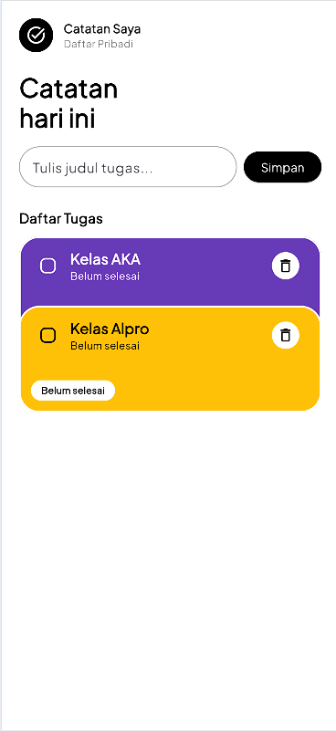

# Mini Task Tracker / Catatan Harian Sederhana


---

## Identitas Peserta
- **Nama:** Rhaihan Aditya Hidayat
- **NIM:** 103022500105

---


## Screenshot / Demo Aplikasi

### Demo Aplikasi


### Referensi UI


---

## Cara Menjalankan Aplikasi (How to Run)
1. Pastikan **Flutter SDK** sudah terpasang di perangkat kamu (`flutter --version`).
2. Clone repositori ini:
   ```bash
   git clone <url-repositori-github>
   cd Motion-StudyCase
   ```
3. Ambil semua dependency Flutter:
   ```bash
   flutter pub get
   ```
4. Jalankan aplikasi di emulator atau perangkat fisik:
   ```bash
   flutter run
   ```

---

### Deklarasi Penggunaan AI
- Apakah menggunakan AI? Ya
- Tool AI yang digunakan: Gemini
- Estimasi persentase kontribusi AI: 35%
- Bagian kode/fitur yang dibantu AI:
  Referensi perapihan tampilan komponen `CardTask` pada `lib/widgets/card.dart` dan penyesuaian tampilan `ListView.builder` bertumpuk di `lib/main.dart`.
- Pernyataan:
  "Saya menyatakan bahwa saya memahami alur dan fungsi dari seluruh kode yang ada dalam repositori ini"
